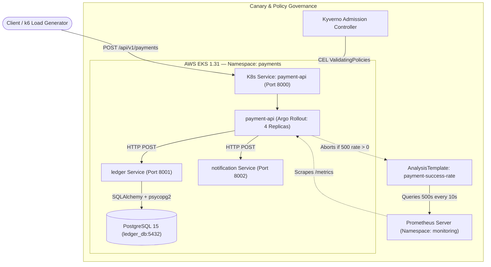
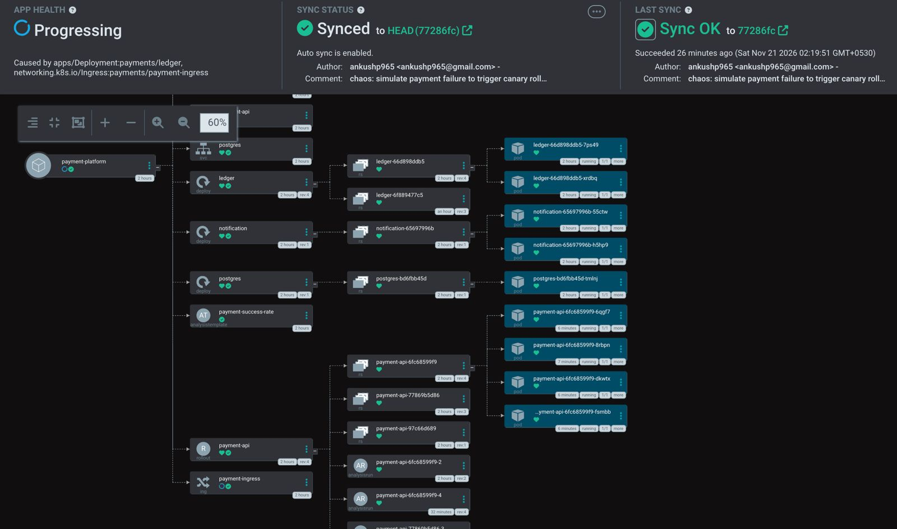
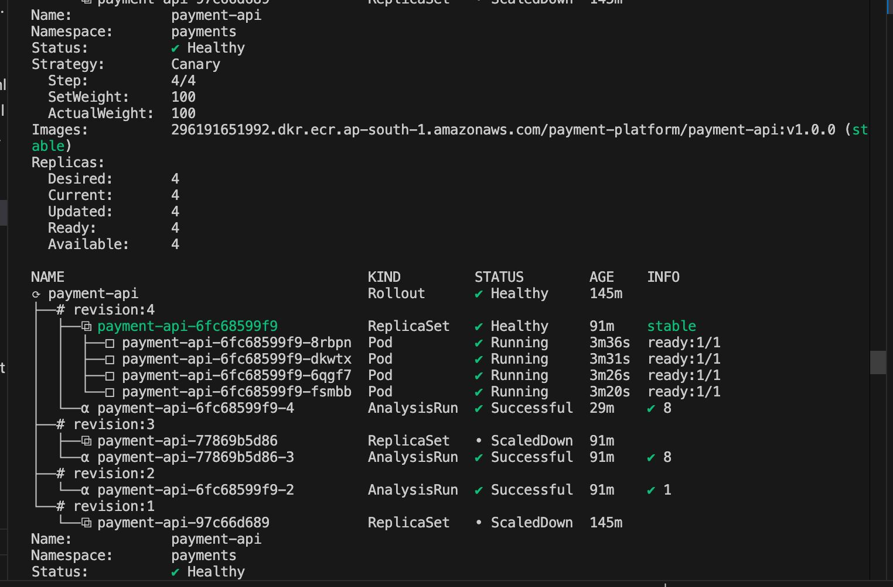
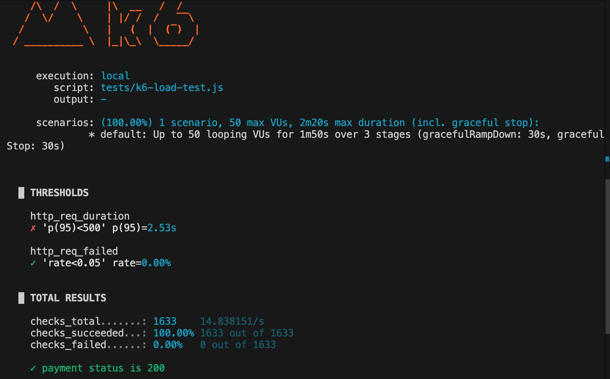
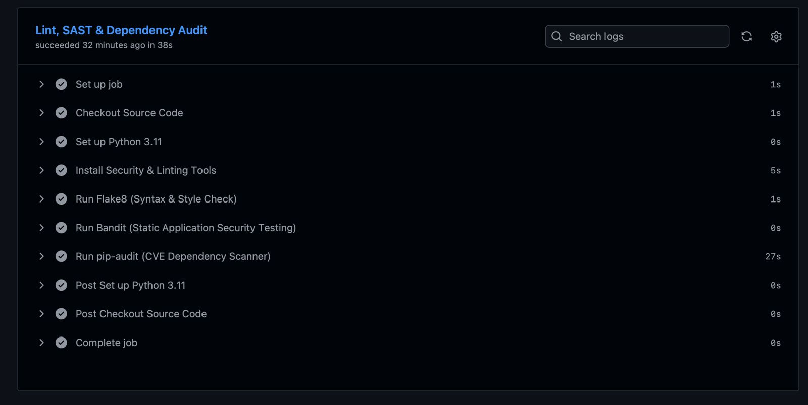
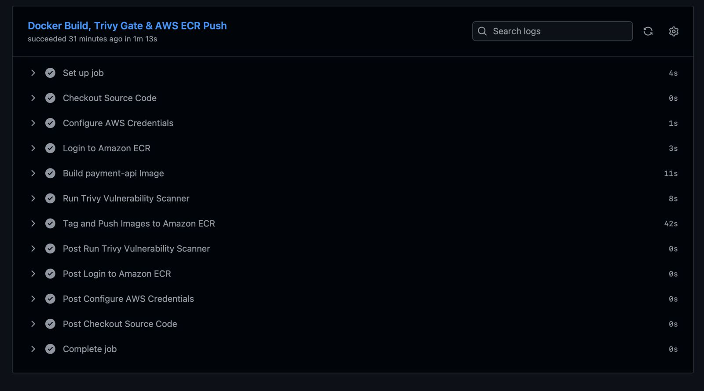

# 💳 Cloud-Native Payment Platform on AWS EKS

> **GitOps, Progressive Canary Deployments & Policy Guardrails**

A demo-scale, cloud-native FinTech payment processing platform built on **AWS EKS (Kubernetes 1.31)** using **Terraform**, **Helm**, **Argo CD**, **Argo Rollouts**, **Prometheus**, and **Kyverno**. This project demonstrates how to safely release updates to payment microservices with automated telemetry-based canary rollbacks, shift-left CI security scanning, and Kubernetes admission guardrails.

---

## 🎯 The Business Problem & Solution

In financial microservices, pushing a buggy release via standard Kubernetes rolling updates risks exposing 100% of users to HTTP 500 errors, failed checkouts, and ledger inconsistencies while engineers scramble to revert manually.

This platform solves that by enforcing automated safety gates at every stage:
1. **Shift-Left CI (GitHub Actions):** Validates syntax, runs static security analysis (Bandit), audits Python dependencies (`pip-audit`), and scans container images (Trivy) before pushing to AWS ECR.
2. **Admission Guardrails (Kyverno CEL):** Blocks pods running as root, using `:latest` tags, or missing CPU/memory limits before they enter the cluster.
3. **Progressive Canary + Auto-Rollback (Argo Rollouts + Prometheus):** Shifts traffic gradually (`25% ➔ 50% ➔ 100%` with 30s pauses) while Prometheus checks HTTP 500 error rates every 10s. If errors persist (`failureLimit: 2`), the rollout aborts automatically and traffic stays on the stable revision.

---

## 🏗 Architecture & Data Flow



### Microservices
* **`payment-api`** (`services/payment-api/`): FastAPI orchestrator (Port `8000`), validates requests, generates `payment_id`, coordinates `ledger` and `notification` calls, and exposes Prometheus metrics (`/metrics`).
* **`ledger`** (`services/ledger/`): FastAPI service (Port `8001`), persists transaction records into PostgreSQL using SQLAlchemy 2.0 (`postgresql+psycopg2://`).
* **`notification`** (`services/notification/`): FastAPI service (Port `8002`), handles downstream payment event notifications.
* **`postgres`** (`charts/payment-platform/templates/postgres.yaml`): PostgreSQL 15 (`postgres:15-alpine`) stateful pod using `strategy: type: Recreate`.

---

## 🛠 Tech Stack

| Layer | Technology / Details |
| :--- | :--- |
| **Cloud & IaC** | AWS EKS `1.31`, Terraform (`>= 1.5.0`), VPC (Public/Private Subnets, Single NAT Gateway), ECR, AWS Secrets Manager, S3 + DynamoDB Remote State |
| **Compute** | 2x `c7i-flex.large` **Spot** Worker Nodes (`min: 1`, `max: 3`, `desired: 2`) |
| **GitOps & Delivery** | Helm (`v2` chart), Argo CD (Declarative GitOps + Self-Heal), Argo Rollouts (`argoproj.io/v1alpha1`) |
| **Observability** | Prometheus Community Server, `prometheus-client` Python instrumentation |
| **Policy & Security** | Kyverno CEL `ValidatingPolicy` (`policies.kyverno.io/v1alpha1`), GitHub Actions (Flake8, Bandit, `pip-audit`, Trivy) |
| **Application & Testing** | Python `3.11-slim`, FastAPI `>=0.115.0`, Starlette `>=1.1.0`, SQLAlchemy `>=2.0.28`, PostgreSQL `15-alpine`, Grafana k6 |

---

## 📸 Visual Proof & Live Screenshots

### 1. Argo CD GitOps Resource Tree
Declarative synchronization of the Helm chart (`payment-platform`), showing `payment-api` Rollout, `AnalysisTemplate`, `ledger`, `notification`, and `postgres` pods.


### 2. Argo Rollouts Canary Strategy & Prometheus Analysis
Canary rollout progression (`25% ➔ 50% ➔ 100%`) with `AnalysisRun` verification checks passing (`✓ 8`).


### 3. k6 Load Test Summary (50 Concurrent Virtual Users)
Processed **1,633 / 1,633** payment transactions with **100.00% availability (0% failed requests)** across the microservice mesh.


### 4. GitHub Actions DevSecOps CI Pipeline
Automated code quality, SAST, dependency CVE scanning (`pip-audit`), Trivy image scanning, and AWS ECR push on `main`.



---

## 🔒 Security & Policy Guardrails

### CI Pipeline Gates (`.github/workflows/ci.yml`)
* **Flake8:** Blocks builds on fatal Python syntax errors (`E9,F63,F7,F82`).
* **Bandit:** Static Application Security Testing (`-ll -ii`) blocking medium/high severity Python issues.
* **`pip-audit`:** Blocks builds on vulnerable dependencies. Caught **14 Starlette CVEs**, resolved by upgrading `fastapi>=0.115.0` and `starlette>=1.1.0` across all services.
* **Trivy:** Scans built `payment-api` container images for `CRITICAL,HIGH` CVEs (`exit-code: '0'` reporting mode; does not block builds).
* **ECR Push:** Pushes `v1.0.0` images to private AWS ECR repositories on `main` branch only.

### Kyverno CEL Policies (`policies/kyverno-policies.yaml`)
All policies run in **Enforce** mode scoped to the `payments` namespace:
1. **`disallow-latest-tag`:** Blocks containers using `:latest` image tags.
2. **`require-non-root-user`:** Enforces `securityContext.runAsNonRoot: true` (scoped exemption for `app: postgres`).
3. **`require-resource-limits`:** Requires `resources.limits.cpu` and `resources.limits.memory` on all containers.

---

## 🚀 Canary Strategy & Auto-Rollback

Defined in `charts/payment-platform/templates/payment-api.yaml` and `analysis-template.yaml`:
* **Steps:** `25%` traffic weight (pause `30s`) ➔ `50%` traffic weight (pause `30s`) ➔ `100%` promotion.
* **PromQL Query (every `10s`):**
  ```promql
  sum(rate(http_requests_total{endpoint="/api/v1/payments",status="500"}[1m])) or vector(0)
  ```
* **Rollback Threshold:** `successCondition: result[0] == 0` with `failureLimit: 2` (~20 seconds). When simulated HTTP 500 errors were injected during a deployment, Prometheus caught the error spike and Argo Rollouts aborted the canary automatically.

---

## 💰 AWS Cost Architecture (Spot vs On-Demand)

Terraform (`terraform/eks.tf` & `terraform/vpc.tf`) applies two cost-saving configurations:
* **Single NAT Gateway:** `single_nat_gateway = true` avoids idle hourly charges of a second NAT Gateway.
* **Spot Worker Nodes:** `capacity_type = "SPOT"` with 2x `c7i-flex.large` nodes in `ap-south-1` (Mumbai):
  * Estimated On-Demand cost: `2 × ~$0.0898/hr × 730 hrs ≈ $131.10/month`
  * Estimated Spot cost: `2 × ~$0.0360/hr × 730 hrs ≈ $52.56/month` *(~60% estimated compute savings; Spot rates vary)*
* **Secrets Manager Cleanup:** `recovery_window_in_days = 0` prevents post-destroy retention charges.

---

## 🐛 Real Engineering Challenges Solved

1. **SQLAlchemy 2.0 Driver Collision (`psycopg` vs `psycopg2`):**
   * *Issue:* `ledger` pods entered `CrashLoopBackOff` with `ModuleNotFoundError: No module named 'psycopg'` because SQLAlchemy 2.0 defaults `postgresql://` URLs to `psycopg` v3.
   * *Fix:* Updated `DATABASE_URL` in `charts/payment-platform/templates/ledger.yaml` to explicitly use `postgresql+psycopg2://`.
2. **PostgreSQL RollingUpdate Port/Storage Conflict:**
   * *Issue:* Default `RollingUpdate` attempted to schedule a second Postgres pod before terminating the existing one.
   * *Fix:* Switched PostgreSQL Deployment strategy to `type: Recreate`.
3. **Kyverno Non-Root Policy vs PostgreSQL Initialization:**
   * *Issue:* `postgres:15-alpine` initializes directories as root before dropping privileges, triggering Kyverno admission rejection.
   * *Fix:* Added an `objectSelector` exemption (`app: NotIn ["postgres"]`) in `require-non-root-user`.

---

## 📊 Load Testing & Known Limitations

### k6 Load Test (`tests/k6-load-test.js`)
* **Config:** 50 VUs ramp (`30s` to 20 VUs ➔ `1m` at 50 VUs ➔ `20s` ramp down).
* **Availability:** **100%** (`1,633 / 1,633` HTTP 200 responses in the captured run; `0%` failed requests).
* **Latency:** `p(95) = 2.53s` (exceeded the script's `p(95) < 500ms` threshold). Traffic was routed through `kubectl port-forward`, which introduces SPDY stream multiplexing bottlenecks under 50 concurrent VUs (an Ingress-based re-test was not executed before cluster teardown).

### Limitations
* **Demo-Scale Scope:** Deployed temporarily on AWS EKS and torn down via `terraform destroy` after verification.
* **Absolute Error Rule:** The canary `AnalysisTemplate` aborts on any `500` rate `> 0` rather than an error-to-total-request ratio (`5xx / total`).
* **Single Database & NAT:** Uses a single in-cluster PostgreSQL pod (not Multi-AZ RDS) and a single NAT Gateway.

---

## 📂 Repository Structure

```text
.
├── .github/workflows/ci.yml        # Flake8, Bandit, pip-audit, Trivy & ECR push
├── charts/payment-platform/        # Helm chart (Rollout, AnalysisTemplate, Deployments)
├── docs/screenshots/               # Captured Argo CD, Rollouts, k6 & CI screenshots
├── policies/kyverno-policies.yaml  # CEL ValidatingPolicies for payments namespace
├── services/                       # FastAPI microservices (payment-api, ledger, notification)
├── terraform/                      # AWS VPC, EKS 1.31 Spot, ECR, Secrets Manager, S3/DynamoDB backend
├── tests/k6-load-test.js           # k6 50-VU load test script
└── docker-compose.yml              # Local multi-container setup
```
